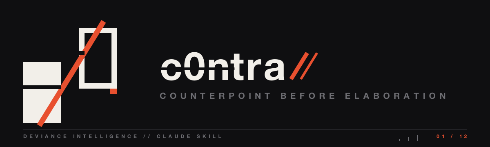
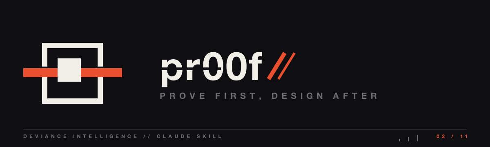
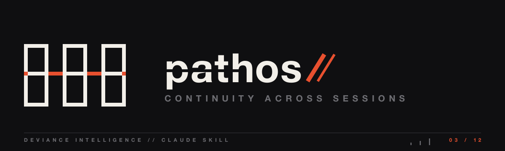
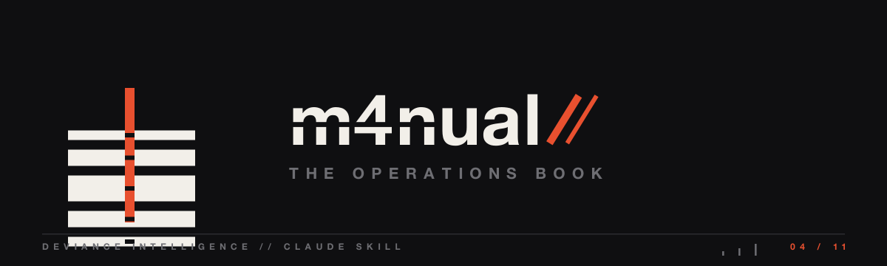
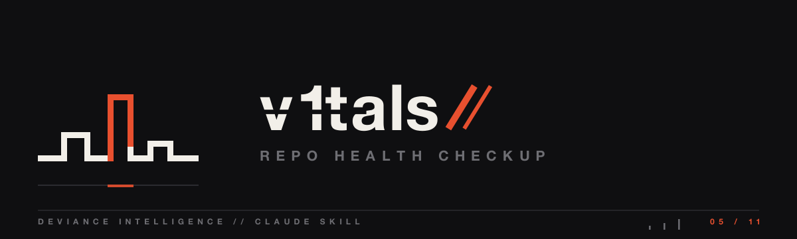
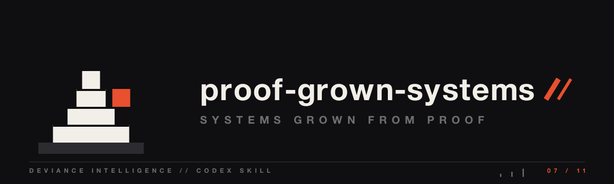
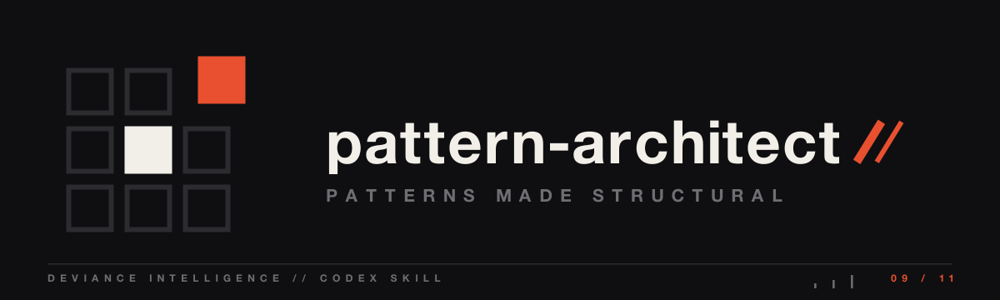
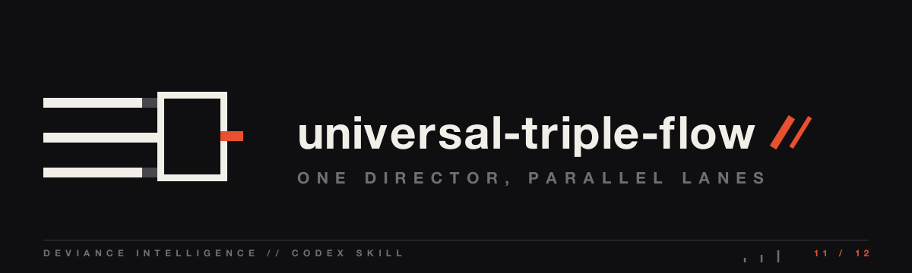

<p align="center">
  
</p>
<p align="center">
  <picture>
    <source media="(prefers-color-scheme: dark)" srcset="assets/deviance-lockup-bone.png">
    
  </picture>
</p>

# deviance-skills

Packaged operating doctrine — the method an agent carries into the work.

**Pinned skills:** [c0ntra](claude/c0ntra/) · [pr00f](claude/pr00f/) · [m4nual](claude/m4nual/) · [v1tals](claude/v1tals/) · [git-postman](codex/git-postman/) · [pattern-architect](codex/pattern-architect/)

## What this is

These are skills for Claude Code (`~/.claude/skills/`) and Codex CLI (`~/.codex/skills/`). Each one is a procedure an agent loads on demand: a fixed way to run a class of work — brainstorm counterpoint, a prove-first feature rite, a session handoff, a repo health checkup. They were pulled from a setup in daily use, and these are the ones that survived it. Copy the folder you want into your skills directory and the agent picks it up.

## The skills

### Claude Code — `claude/`

[](claude/c0ntra/)

Counterpoint for brainstorm mode: reconstruct the idea from first principles, sweep fixed critique lenses, rank the structural holes, then disagree for real or say there is none.

[](claude/pr00f/)

Prove first, design after: an isolated lab whose contract battery starts red before any code, an adversarial and property harness taken up to a real oracle, then a PRD distilled from what the spike proved.

[](claude/pathos/)

A handoff protocol that turns a session's state, access map, proof standard, and next-agent prompt into a file the next chat or agent reads first; ships a backup-first cleanup mode and a `pathos` CLI.

[](claude/m4nual/)

Builds the canonical operations book of a system from one source — a greppable `MANUAL.md` for agents plus a generated human page — with typed anchors that must grep against the real code.

[](claude/v1tals/)

A periodic repo checkup across technical debt, real browser e2e, design taste, ergonomics, animation, performance, and doc-to-code coherence, ending in dispatched fixes rather than a report.

[](claude/sc4le/)

Answers scaling and system-design questions from a local ByteByteGo knowledge base, grounding the answer in how Figma, Discord, Netflix and others solved it instead of generic theory.

### Codex CLI — `codex/`

[](codex/proof-grown-systems/)

The SAMBA method: contract first, build from it, prove behavior with artifacts, close a checkpoint, expand only through new contracts — with a hypothesis-to-class ladder that keeps claims proportional to evidence.

[](codex/git-postman/)

A reputation guard for anything public — commits, PR titles, release notes, README lines — that enforces maintainer voice over assistant voice behind a secrets, identity, and force-push safety gate; ships a commit-message linter.

[](codex/pattern-architect/)

Two cognitive modes for turning an idea into a reusable generator and then into product surfaces: diagnose the wound, distill the sensibility, declare the exclusions, build the generator before any feature.

[](codex/universal-triple-flow/)

An orchestration pattern for one director thread plus two or more Codex CLI lanes in tmux, with a lane matrix, disjoint write scopes, and a shared channel file so lanes never duplicate work.

[](codex/fastlane/)

A delegation workflow that hands bounded implementation to a fast Codex worker while the parent keeps architecture, proof, and integration — baseline snapshot, anti-false-positive checks, and a model fallback when the worker is unavailable.

`c0ntra` is proven, not presumed. It ships with a complete A/B harness in `claude/c0ntra/research/spike/`: a battery of cases with an answer key, a blind judge, a runner, and the recorded transcripts and verdicts. In that spike the armed procedure named 5.67 of 6 structural holes on brainstorm cases against 2.33 vanilla, and dropped "went with the framing" to zero. It is a small directional run (n=10, single judge), and the write-up says so — the win is in brainstorm critique, not in stopping factual flips, which the baseline already resisted.

The banners are generated, not drawn one-off: `assets/banners/generate.py` emits all eleven from the DEViance hermetic form grammar (phi rails, rhythm cuts, bone/void/signal). Change the grammar, regenerate the set.

## Install

Copy the skill folder you want into your agent's skills directory.

Claude Code:

```bash
cp -r claude/c0ntra ~/.claude/skills/
```

Codex CLI:

```bash
cp -r codex/git-postman ~/.codex/skills/
```

`sc4le` clones the public knowledge base it reads (ByteByteGo `system-design-101`) on first use when the clone is missing, so it works from a fresh copy.

## Status — honest

These were extracted from a setup in daily use, not written for display. Several lean on other tools from that setup — m1nd, d0nor, askGOD, uiproof, a fast Codex worker, a local knowledge base. Where a skill does, it names the dependency and degrades with a note instead of failing: the default march runs without external search, the CLI falls back to a bundled script, the worker falls back to another model, the knowledge base clones itself.

The `m1nd-first` skill is not here. It ships with the m1nd repo it belongs to: https://github.com/maxkle1nz/m1nd

## Continue from here

MIT licensed — fork it. The way to add one is to write your own variation of a skill and test it against real use. That is how the skills here earned their spot.

---
<p align="center">
  
  <br>
  <sub>A <b>DEViance Intelligence</b> prototype — <i>beyond the edge</i> · by <a href="https://github.com/maxkle1nz">Max Kle1nz</a></sub>
</p>
