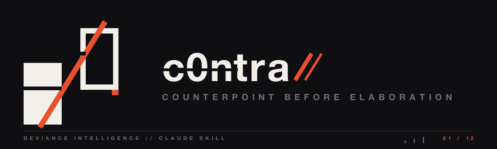

<p align="center">
  <a href="../../README.md"></a>
</p>

# c0ntra

A second voice for raw ideas.

## What it does

When you throw a raw idea, most agents surf your framing and build inside it. c0ntra first rebuilds the idea from first principles, so the view it gives back is its own. Then it tells you three things: what is strong and why, where the idea could grow (including things you did not say), and the few open questions that change the design, each with a way through. It always draws a map.

It is honest in both directions. A strength has to be specific and come with a reason; a concern has to name what goes wrong and offer a path. It does not flatter and it does not manufacture objections.

The name is counterpoint in the musical sense: an independent line that plays along with yours.

## When it fires

Fires on raw brainstorm — "what if we…", "thinking about…", "what do you reckon". Not for factual Q&A, a direct order, or a finished design already under review.

## Install

```bash
cp -r claude/c0ntra ~/.claude/skills/
```

It ships with its own blind A/B harness in `research/spike/` — the cases, an answer key, a blind judge, and the recorded verdicts. The proof travels with the skill.

## Changelog

### v0.3 — 2026-11-18: balance

**Why.** Field report from the owner after a product pitch: the output was "too negative and blind to the strong points" — a map full of holes, risk tables and a disagreement section, with a line or two on what was good. The cause was in the skill text: a quota of "at least one genuine disagreement", lenses that only asked what was missing, and an output skeleton with no section for strengths or growth.

**What changed.**
- Lenses now ask two questions each (what is strong here, what is still unanswered), plus two new ones: the owner's own advantage, and the ceiling if it goes very well.
- The disagreement quota is gone. One rule covers praise and concern alike: specific, with a mechanism, with a consequence. Generic praise is banned.
- Output skeleton: `A IDEIA · O MAPA · (UML) · O QUE BRILHA · ONDE CRESCE · O QUE PRECISA DE RESPOSTA · PRÓXIMO PASSO`. It replaces `ONDE BATE / ONDE QUEBRA · DISCORDÂNCIA · PERGUNTAS`. The positive sections take at least as much space as the open questions.
- At most three open questions in the text, each written as "How…?" with a way through. No risk tables. Every other open point still appears on the map.
- Every answer adds at least one idea the owner did not say.
- If one point decides the fate of the idea, it goes on the second line of the answer, not after the praise.
- Map legend has four marks: owner · mine (`+`) · strong (`★`) · needs an answer (`◆`).
- Description and trigger no longer describe an adversarial procedure.

**What stayed.** Independent reconstruction before reading the proposal, the central premise checked as a testable claim, the fixed lens sweep, the new-evidence gate, the map, the `≠` signature, plain language.

**Sources and regression.** `research/v0.3-equilibrio.md` (PPCO, Klein's pro-mortem, plussing, Rapoport's rules, and 2025-2026 sycophancy research). Regression on the brainstorm class: `research/spike/RESULTS-v0.3.md`, rerun with `python3 research/spike/run_v03.py`. The v0 harness (`run.py`, `INTERVENTION.md`) is frozen; `research/spike/SKILL-v0.2.frozen.md` is the v0.2 text used as the "before" arm.

### v0.2 — output identity (map, legend, signature)
### v0.1 — the seven spike rules plus three amendments

---
<p align="center">
  
  <br>
  <sub>Part of <a href="../../README.md"><b>deviance-skills</b></a> — a DEViance Intelligence pack · <i>beyond the edge</i></sub>
</p>
