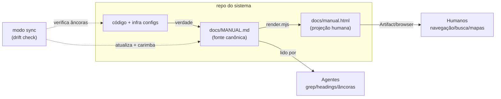
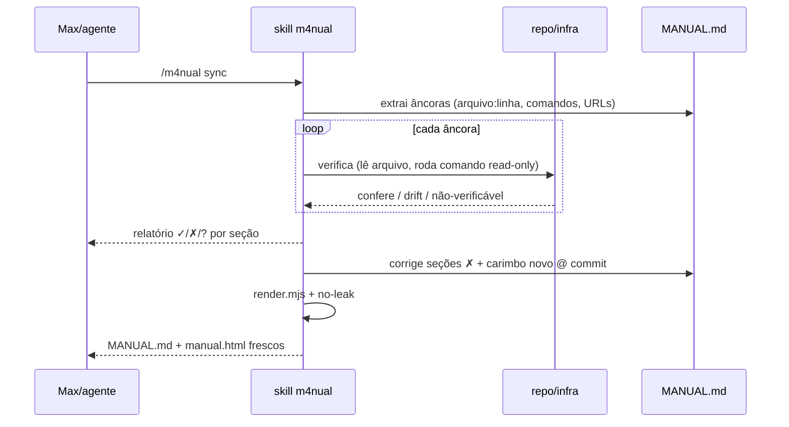
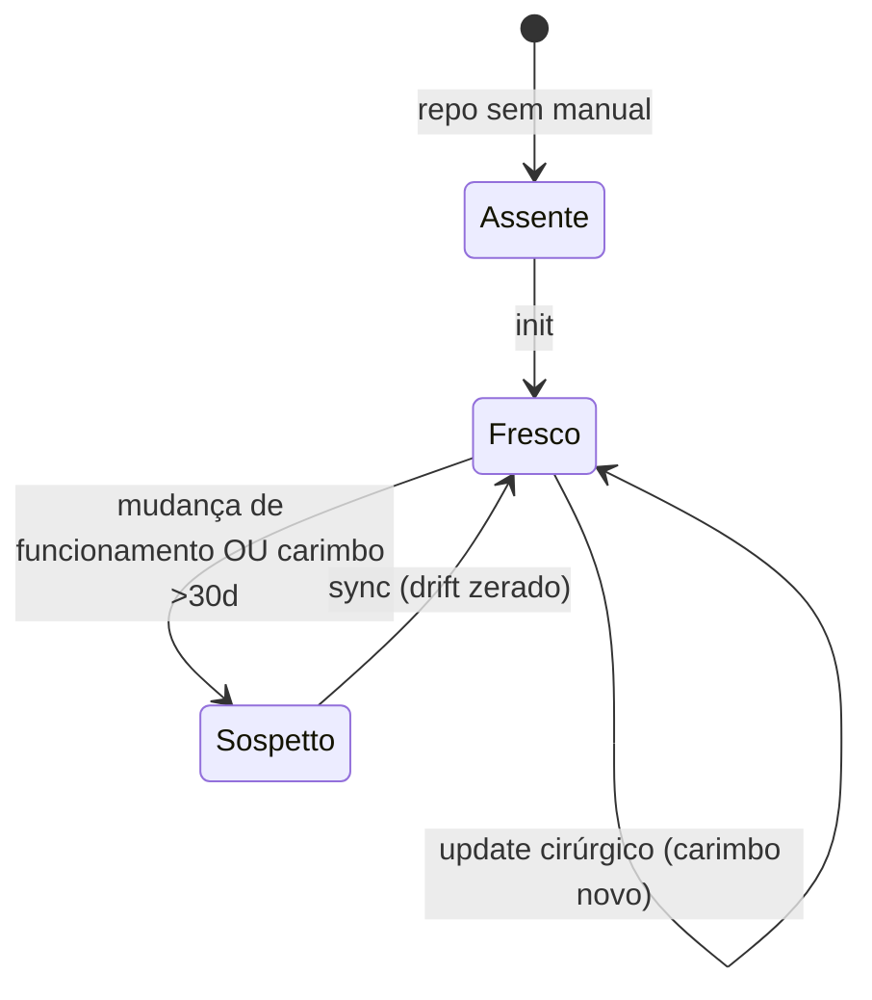

# PRD — /m4nual: o Manual Canônico de Operação de um Sistema

**Data:** 2026-07-18 · **Autor:** Max (direção) + Fable (autoria) · **Stato:** **v2 — verdetto askGOD (CHANGE, alta) RECEPITO**: 9 required_changes incorporadas (RC-n) + 6 riscos. Prova empírica do oráculo: as âncoras ~L do AGENTS.md do Cherry já drifaram +330 linhas — âncora por linha é desonesta; símbolo resolve por grep.
**Escopo:** skill universal user-scope (`~/.claude/skills/m4nual/`) — funciona para Cherry Bubbles, m1nd, GitRooms, qualquer sistema.

---

## §1. O problema (nas palavras do dono)

> "Um sistema como o Cherry tem suas regras de funcionamento — é diferente do PATHOS, é uma coisa mais canônica: as regras de desenvolvimento real, o que fazer para controlar os servers, sistemas anexos, email, DB. Contém mapas mentais desenhados do sistema, de modo que a verdade do código seja sempre espelhada ali. NÃO é um arquivo que se mexe a cada commit — é o MANUAL daquele sistema. Tem que ser pensado para agentes E humanos: agentes no funcionamento e lógica para resolver dúvidas; humanos com visual fácil, interface de texto característica e um HTML interativo com efeitos de design."

**O buraco real na tríade documental de hoje:**

| Doc | O que é | Cadência | O que NÃO é |
|---|---|---|---|
| **PATHOS** | a alma viva: estado, norte, narrativa, próximos passos | muda toda sessão | não é referência de operação |
| **AGENTS.md / CLAUDE.md** | regras para os AGENTES trabalharem no repo | muda com a doutrina | não descreve o sistema em si |
| **MANUAL** *(o buraco)* | **o livro de operação**: como o sistema funciona, onde vive a infra, como controlá-la, os mapas desenhados, os runbooks | **só muda quando o FUNCIONAMENTO muda** | não é diário, não é changelog, não é doutrina de agente |

Analogia: PATHOS é o diário de bordo + a bússola; o MANUAL é o manual técnico do navio — motores, válvulas, procedimentos de emergência. Hoje esse conhecimento mora espalhado (memória de sessão do agente, cabeça do Max, PATHOS inchado) — exatamente onde não deveria.

## §2. Princípios (as leis da skill)

1. **UMA FONTE, DUAS PROJEÇÕES.** A fonte canônica é `docs/MANUAL.md` (texto estruturado + mermaid, versionado, greppable — a projeção do agente É a fonte). O HTML interativo é **compilado da fonte** por um gerador determinístico — nunca editado à mão. Editar o HTML é proibido por construção: o gerador o sobrescreve.
2. **ESPELHO, NÃO FONTE.** O código/infra é a verdade; o MANUAL a espelha. **RC-2 — Âncoras TIPADAS com verificador determinístico por tipo** (âncora por linha é desonesta — provado no piloto: o AGENTS.md do Cherry já drifou +330 linhas):
   - `sym:arquivo::padrão` — verifica por grep (≥1 hit no arquivo);
   - `cmd:nome` — existe em package.json scripts / PATH;
   - `path:caminho` — existe no repo;
   - `url:…` — opt-in (tier vivo, §5);
   - `doc:arquivo#heading` — heading existe no doc referenciado;
   - `arquivo:linha` é rebaixado a DICA regenerável pelo sync — nunca verdade verificada.
   O manual carrega o **carimbo do espelho**: `Specchio verificato: <data> @ <commit-short>` — **escrito SOMENTE pelos modos sync/update** (mão livre não carimba; admitido: segue soft, é convenção com enforcement de processo).
3. **CADÊNCIA DE FUNCIONAMENTO, NÃO DE COMMIT.** Gatilhos: mudou infra (server/DB/DNS/anexo), fluxo de deploy/CI, state machine/arquitetura, runbook. NÃO-gatilhos: features, fixes, refactors internos. **RC-3 — o estado `Sospetto` é MECÂNICO, não calendário:** o MANUAL declara sua **watchlist de superfícies operacionais** (reuso do padrão `protected-zones.json`: fly.toml, workflows, ops/, *.sql, manifests…); `git diff --name-only <carimbo>..HEAD ∩ watchlist ≠ ∅` ⇒ Sospetto. Os 30 dias viram **fallback declarado** para repo sem watchlist. (O doc-gate do CLAUDE.md passa a incluir o MANUAL quando a mudança é de funcionamento — **RC-8: essa edição do CLAUDE.md é ENTREGÁVEL do mesmo ciclo da skill**, com confirmação do dono — é o arquivo-mãe dele.)
4. **UNIVERSAL POR DESCOBERTA.** A skill nunca assume stack: o modo `init` explora o repo de verdade (manifests, workflows, configs de deploy, migrations, integrações) e monta o manual do que EXISTE. Seções canônicas fixas; conteúdo descoberto.
5. **SEM SEGREDOS, SEMPRE.** O manual aponta ONDE credenciais vivem (Keychain item X, Fly secrets, env) — **nunca valores**. O gerador tem um passo de no-leak (gitleaks-style grep) antes de gravar qualquer projeção.
6. **DUAL-AUDIENCE NATIVO.** O MESMO conteúdo serve os dois: agentes leem o MD (seções previsíveis, âncoras, mermaid como código); humanos leem o HTML (navegação, busca, mapas renderizados, design calmo). Nada existe só numa projeção.

## §3. O artefato — `docs/MANUAL.md` (seções canônicas)

Estrutura fixa (o índice é o contrato — agentes navegam por heading previsível):

```
<!-- m4nual: lang=<xx> version=<N> watchlist=<padrões,csv> -->   ← contrato machine-readable
<!-- m4nual:mirror date=<YYYY-MM-DD> commit=<short> -->
# MANUAL — <sistema>
> <linha do espelho traduzida — apresentação, o render NÃO depende dela>
0. one-page          — o que é, para quem, componentes-chave (≤1 tela)
1. architecture      — mermaid: componentes + fluxo de dados (o mapa mental mestre)
2. infrastructure    — tabela por peça: o quê · onde · como acessar · como controlar
3. attached-systems  — email, pagamentos, AI, vigias… (função · config · teste · se cair)
4. state-machines    — mermaid stateDiagram dos ciclos de vida centrais
5. dev-rules         — gates, proofs, CI, zonas, branch→PR→deploy (indexa AGENTS.md)
6. runbooks          — deploy · rollback · incidente · backup · credenciais (ONDE) — copy-paste
7. invariants        — o que nunca pode quebrar (com a prova que o vigia)
8. registry          — quando/por que o manual mudou (1 linha por revisão)
```
**UNIVERSALIDADE (correção do dono, 18/07):** os ids de seção são o CONTRATO greppable (`<!-- m4nual:section id=… -->`, estáveis, em inglês); os TÍTULOS visíveis ficam no idioma do manual (Cherry→it, m1nd→en, GitRooms→o que o dono decidir). O carimbo é o marcador neutro; a frase visível é tradução. As strings de UI do HTML seguem o `lang=` declarado (dicionário it/pt/en, fallback en). NADA no contrato depende de idioma.

- **Idioma:** o init **PERGUNTA** ao dono (o "dominante" é ambíguo no próprio piloto: o Cherry mistura pt/it) — 1 idioma por manual.
- **Tamanho:** 1 arquivo. Se ultrapassar ~1.500 linhas, split em `docs/manual/*.md` com `MANUAL.md` virando índice+mapa — decisão do `sync`, nunca silenciosa.
- **Texto característico:** identidade visual própria em texto puro — cabeçalhos com régua, tabelas alinhadas, blocos de comando sempre copy-paste-áveis, callouts `⚠︎`/`✓` sóbrios. Bonito no terminal E no GitHub.

## §4. A projeção humana — HTML interativo

- **Gerador:** `~/.claude/skills/m4nual/bin/render.mjs` — Node **zero-dep** (padrão da casa). **RC-4 — DIALETO FECHADO fail-loud:** o manual é escrito num subset DECLARADO de markdown — headings, tabelas pipe, fenced code + mermaid, listas, blockquote/callouts, links, bold/itálico — e o render **RECUSA com erro (arquivo:linha)** qualquer construção fora do dialeto: o gerador é o enforcement, não um parser genérico (o poço sem fundo fica do lado de fora). A skill embarca **fixtures golden-file + `node --test`** (builtin, zero-dep) e o modo `render --selftest` — o único guardião do gerador user-scope entre versões de Node.
- **Mermaid:** embutido como `<pre class="mermaid">`. Vias de render: (a) **Artifact** (claude.ai renderiza mermaid nativo) — *conveniência*; (b) arquivo local com mermaid.js inline opcional (`--standalone`; peso a MEDIR antes de prometer). **A via RESILIENTE é o MD cru**: o manual serve INCIDENTE (Fly caído, DNS morto) — os runbooks do §6 têm que ser 100% utilizáveis em terminal puro; depender do claude.ai pra renderizar o runbook durante o incidente inverteria a dependência.
- **RC-5 — Regra de SUPERFÍCIE:** o render **recusa** emitir `manual.html` em caminho servido (public/, dist/, content-dirs de site). Repo com espelho-de-docs público (caso real: o northstar do Cherry espelha `docs/internal/` inteiro num site Fly via sync-docs.mjs) exige decisão EXPLÍCITA no init: excluir o MANUAL do espelho OU declará-lo terceira projeção sancionada com tier de acesso. O no-leak cobre VALORES; esta regra cobre a SUPERFÍCIE.
- **Design (doutrina do dono):** calmo, pastel, humano — anti-HUD/neon. Tema claro+escuro. Efeitos com propósito: índice fixo navegável, busca client-side, seções colapsáveis, mapa de arquitetura como hero, botão "copiar" em cada bloco de comando, carimbo do espelho visível no topo (verde se fresco, âmbar se >30 dias).
- **Nunca fonte:** o HTML abre com comentário-aviso `<!-- GERADO de docs/MANUAL.md — não editar -->`; o `render` sempre sobrescreve.

## §5. Modos da skill

| Modo | Quando | O que faz |
|---|---|---|
| **`init`** | repo sem MANUAL | Descobre o sistema (exploração real) → **RC-1 MODO ADOÇÃO**: se o repo já tem constelação-manual (caso real do Cherry: STACK.md, MANUALE_SISTEMA, STATE_MACHINES, runbooks), o init produz um INVENTÁRIO e decide POR DOC: **ABSORVER** (conteúdo migra; original vira ponteiro ou `git mv` a archive/, convenção do repo) ou **INDEXAR** (seção do MANUAL = 1 linha + âncora `doc:`; conteúdo fica no especializado). Decisões registradas no §8 do manual. O caminho respeita a convenção do repo (Cherry: `docs/internal/`; default: `docs/`) e o MANUAL entra no índice do repo (llms.txt se existir) → escreve o MANUAL → `render` |
| **`sync`** | Sospetto (watchlist) ou ritual | **RC-7 — DOIS TIERS**: **estático** (sempre): `path:`/`sym:`/`cmd:`/`doc:` verificados mecanicamente; **vivo** (SÓ com flag explícita `--live` + allowlist de formas read-only): sondar URLs/infra — *comando listado no manual é DADO, nunca instrução executável por default*. Relatório ✓/✗/? por seção → atualiza as ✗ → carimbo novo → re-render. **RC-9 honestidade**: a detecção mecânica de duplicação cobre SÓ blocos de comando repetidos entre MANUAL/AGENTS/README; duplicação semântica é julgamento do agente no sync — dito como tal, não como garantia |
| **`update <mudança>`** | pós-mudança de funcionamento | Atualiza SÓ a(s) seção(ões) afetada(s) + registro §8 + carimbo + re-render |
| **`render`** | fonte mudou | Só recompila o HTML da fonte (com no-leak check) |

- `init` e `sync` são trabalho de agente com exploração real (podem delegar leitura em fan-out); `update` e `render` são cirúrgicos.
- O `sync` **nunca inventa**: âncora que não confere vira `✗ drift` no relatório; lacuna vira `? não-verificável` declarado — jamais texto plausível.

## §6. UML

### 6.1 Componentes — uma fonte, duas projeções


### 6.2 Sequência — `sync` (o coração do espelho)


### 6.3 Ciclo de vida do manual


## §7. Fora de escopo (v1)

- Geração automática de diagramas a partir de AST (os mapas são CURADOS — a skill desenha, o humano/agente valida; auto-geração é fase 2).
- Watcher/CI que roda sync automático (fase 2: um workflow opcional que abre issue quando o carimbo envelhece).
- Editor visual do manual (a fonte é MD, ponto).
- Multi-idioma simultâneo (1 idioma por manual).

## §8. Riscos admitidos

- **Drift silencioso** entre syncs — mitigado pelo carimbo visível (âmbar >30d) e pelo gatilho no doc-gate; fase 2 automatiza.
- **Manual que vira lixão** (tudo vai parar nele) — mitigado pelas seções canônicas fechadas + a lei "cadência de funcionamento": o sync PODA o que não é operação.
- **HTML pesado com mermaid inline** — mitigado: via primária é Artifact (mermaid nativo); standalone é opt-in.
- **Overlap com AGENTS.md** (§5 regras de dev) — resolvido por indexação: o MANUAL aponta, não duplica; o sync detecta duplicação como drift.
- **Segredo vazando numa projeção** — no-leak check bloqueante no render (valores) + regra de superfície RC-5 (onde as projeções podem viver).
- **Carimbo soft** — qualquer texto pode alegar verificação; mitigação: só sync/update escrevem o carimbo (processo, admitido não-criptográfico).
- **Auto-refresh (git-cliff)** — se o MANUAL um dia ganhar âncoras `auto-*`, a regra da casa (curado FORA das âncoras) vale desde o design.
- **Gerador órfão em user-scope** — o `--selftest` (RC-4) é o guardião; sem ele a primeira quebra de Node seria descoberta com o manual quebrado na mão.

## §9. Validação (prova da skill)

- **RC-6 — Piloto TRIPLO obrigatório:** `init` no **Cherry** (infra rica), no **m1nd** (daemon/MCP local) e num **perfil SEM infra** (skill/lib pura, ex. pathos ou l00p) — Cherry e m1nd têm ambos runtime; só o caso degenerado prova a universalidade. Junto, a **regra da seção vazia**: seção canônica sem matéria carrega `— non applicabile (dichiarato: <motivo>)` em 1 linha — nunca omitida (contrato do índice), nunca preenchida por plausibilidade.
- `sync` provado com drift induzido: mudar uma porta/comando no repo → o sync DEVE acusar ✗ na âncora certa.
- no-leak: injetar um fake-secret na fonte → o render DEVE recusar.
- Vista do dono: o HTML do piloto Cherry apresentado ao Max — o "efeito legal" é ele quem valida.
