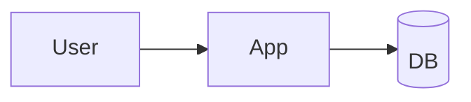

<!-- m4nual: lang=en version=1 -->
<!-- m4nual:mirror date=2026-07-18 commit=abc1234 -->
# MANUAL — Example System

> Mirror verified: 2026-07-18 @ abc1234   ·   Manual v1   ·   Watchlist: fly.toml, .github/

This is a **manual** *example* with `inline code` and a [link](https://example.com).

<!-- m4nual:section id=infra -->
## Infrastructure & control

Component table:

| Piece | Where | How to control |
|---|---|---|
| Server | Fly.io | `flyctl status` |
| DB | Neon | dashboard |

Main steps:

- First point
- Second point
  - Nested sub-point
- Third point

```bash
flyctl deploy --remote-only
```

<!-- m4nual:section id=maps -->
## Architecture map



> Note: this blockquote explains an important rule.

---

End of the manual.
