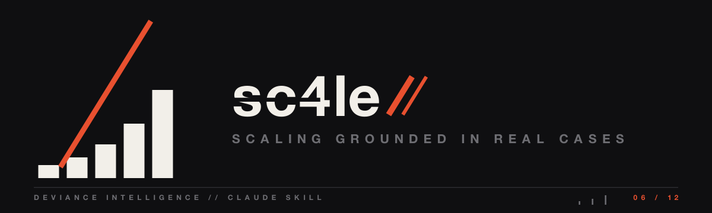

<p align="center">
  <a href="../../README.md"></a>
</p>

# sc4le

"How do I scale this?" — answered by whoever already got paged for it.

## What it does

Answers scaling and system-design questions from a local knowledge base of ~400 visual guides and real case studies. Instead of generic theory it grounds the answer in how Figma, Discord, Netflix, Uber and others actually solved the same problem.

## When it fires

"How do I scale X?", "who already solved this?", bottleneck and capacity questions. Not for implementing the change — it's consultative — and not for library docs.

## Install

```bash
cp -r claude/sc4le ~/.claude/skills/
```

On first use it clones the public knowledge base it reads (ByteByteGo `system-design-101`) when it's missing, so it works from a fresh copy.

---
<p align="center">
  
  <br>
  <sub>Part of <a href="../../README.md"><b>deviance-skills</b></a> — a DEViance Intelligence pack · <i>beyond the edge</i></sub>
</p>
