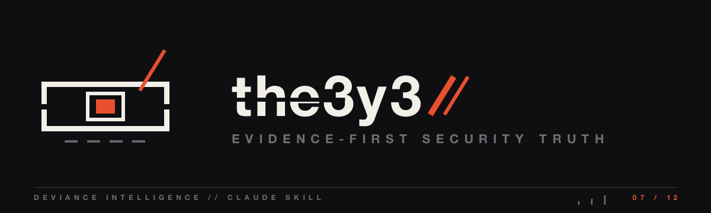

<p align="center">
  <a href="../../README.md"></a>
</p>

# the3y3

The current security truth of a repo — evidence-first, read-only.

## What it does

A read-only cybersecurity assessment that reports what is actually true: attack surface, trust boundaries, exploitable paths, control gaps, supply chain, CI/CD, secrets, identity, data handling, and agentic workflows. Every finding comes with its evidence — nothing is asserted.

## When it fires

Repo security audits, AppSec review, threat modeling, secure code review, due diligence. Not for ordinary implementation or generic code review.

## Install

```bash
cp -r claude/the3y3 ~/.claude/skills/
```

---
<p align="center">
  
  <br>
  <sub>Part of <a href="../../README.md"><b>deviance-skills</b></a> — a DEViance Intelligence pack · <i>beyond the edge</i></sub>
</p>
