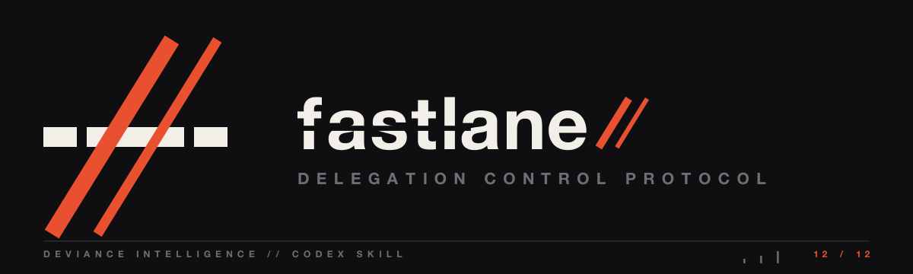

<p align="center">
  <a href="../../README.md"></a>
</p>

# fastlane

Delegate construction. Centralize judgment.

## What it does

A delegation workflow: bounded implementation goes to a fast Codex worker while the parent keeps architecture, proof, and integration. It takes a baseline snapshot, runs anti-false-positive checks so that "green" actually means something, and falls back to another model when the worker is unavailable. Proof, not "tests passed", decides whether the result ships.

## When it fires

When a frontier parent should stop burning reasoning on mechanical edits and hand bounded slices to a worker.

## Install

```bash
cp -r codex/fastlane ~/.codex/skills/
```

---
<p align="center">
  
  <br>
  <sub>Part of <a href="../../README.md"><b>deviance-skills</b></a> — a DEViance Intelligence pack · <i>beyond the edge</i></sub>
</p>
